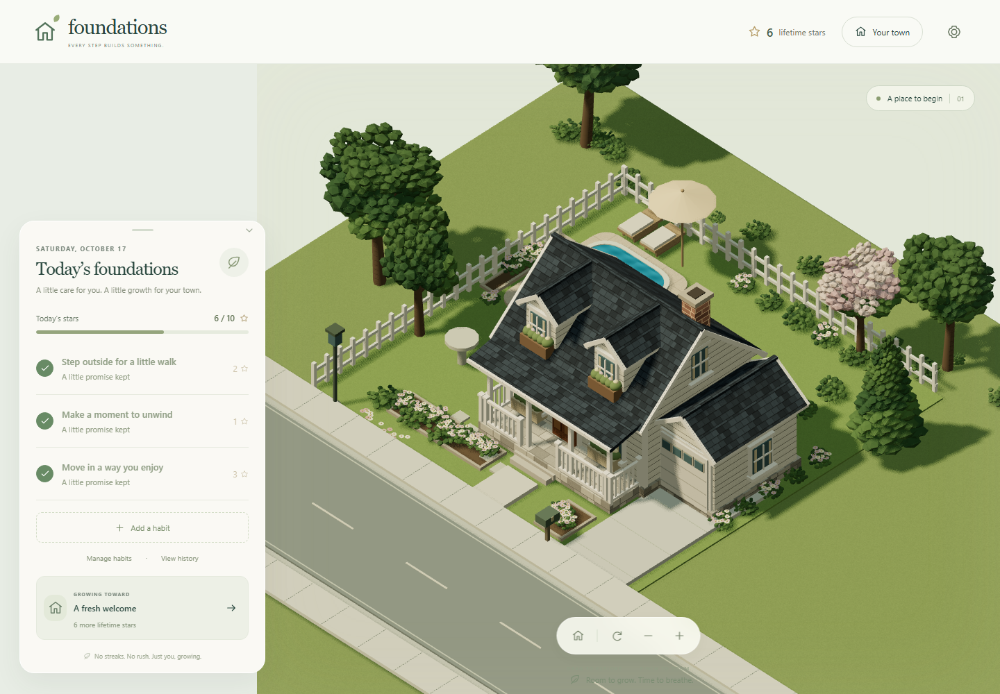

# Foundations

Build healthy foundations for life. Every step builds something.

A private, portrait-first wellness companion. Healthy habits earn permanent stars that gradually build a peaceful miniature suburban town. No accounts, shop, spendable currency, streaks, penalties, analytics or tracking.

**Live app:** https://haydenmay.github.io/foundations/  
**Source:** https://github.com/HaydenMay/foundations



Visual Production Pass 1 refines the starting residential lot using the approved cozy miniature references: three house styles, detailed gardens, interchangeable backyards and four lighting moods. Phase 4 carries that same lot through its first 100 lifetime stars with free, reversible A/B/C compositions. See the [visual report and screenshot gallery](docs/visual-pass-1-results.md) and [Phase 4 results and reference sets](docs/phase-4-results.md).

Phase 2 adds an empty-lot beginning, a first-home choice after the first valid habit completion, and an isolated Developer Preview. Existing players keep their houses. See the [Phase 2 implementation and validation report](docs/phase-2-results.md).

## Run locally

Use Node **24.15.0+** (or a version supported by Angular 22: `^22.22.3 || ^24.15.0 || >=26.0.0`) and npm.

```sh
npm ci
npm start
```

Open the URL printed by Angular (normally http://localhost:4200). The application has no server-side data service, API keys or environment secrets.

```sh
npm test                       # Vitest domain and persistence tests, non-watch
npm run build                  # Production build, /foundations/ base path
npm run preview                # http://127.0.0.1:4200/foundations/
```

The automated suite is intentionally limited to fast unit tests and the production build. Optional visual evidence scripts in `scripts/` use Playwright and synthetic browser profiles; they are manual capture tools, not tests or deployment gates.

If the host Node is older, a temporary runtime works without upgrading the machine:

```sh
npm exec --yes --package=node@24.15.0 -- npm test
npm exec --yes --package=node@24.15.0 -- npm run build
```

## How progress works

- Easy / Moderate / Hard habits earn **1 / 2 / 3 stars**. The daily maximum is **10**. A three-star goal completed at nine earns one star; later completions still enter history with zero stars.
- Three editable starter habits are eligible immediately. Custom habits start on the **following local calendar day** and first appear in Today then.
- Daily habits count once per local date. Selected weekdays use the device's weekday. Weekly habits can be completed on any day, once per **Monday–Sunday local week**. One-time goals count once ever, even if their frequency is later edited.
- No backdating or completion deletion. Completions are permanent snapshots; edits never change past names, difficulties or rewards. Changing a schedule cannot score the same goal twice on the same date. Pausing or archiving preserves all history. Archived goals can be restored.
- Missed days have no effect. Stars never expire, and there are no consecutive-day bonuses. Lifetime stars are calculated from the persisted reward history, never spent.
- The device clock defines dates. This is a trust-based personal tool, with no server clock or anti-cheat system. Changing timezones follows the new local date. A tab updates its date on focus and every 30 seconds while open.

|               Lifetime stars | Project                   | Design choices                                       |
| ---------------------------: | ------------------------- | ---------------------------------------------------- |
| First valid habit completion | Your First Home           | Classic Cottage, Modern Craftsman, Traditional Brick |
|                           10 | A Garden at the Door      | Red roses, orange flowers, blue flowers              |
|                           20 | A Garden Centerpiece      | Flowering tree, stone fountain, birdbath             |
|                           30 | A Backyard Favorite       | Swimming pool, trampoline, wooden play fort          |
|                           40 | A Welcoming Porch         | Rocking chairs, porch swing, bench + lanterns        |
|                           50 | A Place to Unwind         | Pergola seating, stone patio, garden lounge          |
|                           60 | Room to Bloom             | Flower beds, evergreen shrubs, wildflowers           |
|                           70 | A Gentle Property Edge    | Picket fence, trimmed hedge, low stone wall          |
|                           80 | A Warm Welcome After Dark | String lights, garden torches, exterior wall sconces |
|                           90 | Your Garden Signature     | Decorative pond, gazebo, ornamental display garden   |
|                          100 | Chapter completion        | Peaceful reveal of the next empty lot                |

All earned projects remain available in **Your town** until you choose a design. Nothing is automatically skipped. Construction and every later design change are free and reversible. Each choice changes the actual 3D environment. The 100-star reveal is an empty lot in the same continuous world, not a new building or a separate map.

Genuinely new profiles start on the same peaceful residential lot with no house. Any valid recorded habit completion unlocks **Your First Home**, including a completion that earns zero stars at the daily cap. Preview each existing house in the live town, then confirm. The home is saved before a short construction celebration begins. Skip finishes immediately; reduced motion shows the completed home directly. Reloading during construction shows the saved house. Choose later leaves the selection available in **Your town**, and **Design Your First Home** reopens the same free selector after construction.

## Developer Preview

Settings → **Developer Preview** → **Enter Developer Preview** creates a disposable working copy. The green **DEVELOPER PREVIEW** badge and Exit remain visible; tap the badge to reopen controls. Collapse the panel to explore the town. Controls cover five scenarios, simulated lifetime stars and milestone jumps, all current house and project compositions, backyard choices/visibility, lighting, and camera reset/position/zoom/rotation. Locked designs are available in preview only. No new projects or currency are introduced.

Real state and preview state occupy separate signals. Preview actions, camera updates, construction, and simulated stars never write to storage or other tabs. JSON exports always contain the latest genuine progress; imports are disabled during preview. Real updates from another tab remain authoritative behind the working copy. Exit reveals that genuine state; reload discards preview entirely. This is a client-side visualization tool available in production, not an access-control or security boundary.

## Camera and atmosphere

Drag with a mouse or one finger to pan. Pinch with two fingers or use the mouse wheel to zoom. Home, rotate, zoom-in and zoom-out controls are available on screen. Focus the canvas for arrow-key pan, `+` / `-` zoom, `R` rotation and `Home`. Movement and zoom are bounded; camera preferences and the habit panel state survive reloads.

Lighting follows the **device's local time**, blending morning, afternoon, sunset and night colors, sun direction, ambient fill and window light. Settings has manual overrides for each. Sunrise/sunset use approximate fixed local hours (around 6 am / 6 pm); no location is requested. Windows and street lamps become warm at night. Rendering is event-driven rather than an endless animation loop, the pixel ratio is capped at two, and static shadows are refreshed only when the world or light changes. Clock lighting updates each minute while open; no perpetual foliage/water animation is enabled.

## Privacy and backups

Habits, schedules, completion snapshots, stars, designs, camera and interface preferences live in browser **localStorage**, under `foundations.v1`. The versioned state is validated on load and import. Multiple same-origin tabs synchronize; browsers with Web Locks serialize startup creation, migration and updates to prevent stale writes or duplicate rewards.

The storage key stays unchanged; the JSON schema is now **version 3**. Valid older profiles migrate conservatively: v1 saves with a house remain existing homeowners, v2 profiles with completions or a house retain the home, and all habits, history, designs and unknown fields are preserved. Before overwriting a stored v1 or v2 record, its exact original bytes are copied once to `foundations.pre-v2` or `foundations.pre-v3`; Settings can export those backups. If the required backup cannot be written, the original record is left intact and an unsaved warning appears. Older JSON imports use the same conservative migration. Unsupported or malformed records remain protected. Close stale tabs after an upgrade; an old app version cannot edit the newer schema.

**Clearing browser/site storage, private browsing cleanup, changing browser profiles or moving devices can lose progress.** Settings → Export backup downloads a JSON file. Import validates the file and shows a confirmation before replacing current progress. Export your current town first if you want to keep both. Backups contain habit names and history: keep them private and never commit them to this public repository.

If an unsaved tab and another tab diverge during a storage failure, both versions are preserved and automatic writes stop. Export the unsaved session, reload to inspect the saved version, and explicitly import the backup you choose to keep. There is no automatic merge.

Malformed saved data is preserved for recovery and never silently reset. Settings can export the original storage. Blocked/full storage triggers a visible warning and permits tracking in the open tab; export before closing. There is no cloud sync, automatic backup or cross-device recovery. Browser storage is not encrypted, and other people using the same browser profile can access it. GitHub hosts application files and receives ordinary hosting requests; the application does not transmit wellness records.

Confirming a first home requires a successful durable save. If browser storage is blocked/full, the choice stays pending and no construction celebration begins. Export the current session, free or enable site storage, and retry before closing the tab.

## Architecture

- `src/app/domain/`: pure TypeScript habit validation, local calendar scheduling, immutable rewards/history, data-driven milestone choices and versioned backup validation.
- `src/app/domain/preview.ts`: pure disposable scenario/control transformations; simulated stars stay outside reward history.
- `src/app/state.service.ts`: separate real/preview signals, session epochs, local persistence, migration backups, multi-tab synchronization, storage failures and real-only exports.
- `src/app/components/`: reusable habit editor, first-home selector, collapsible developer controls and local SVG icons.
- `src/app/app.*` and `src/ui.css`: responsive shell, habit sheet, project inspector, history and settings; native dialogs provide focus trapping and Escape dismissal.
- `src/app/town/assets.ts`: shared material, geometry, texture and disposal ownership; legacy factories for later projects.
- `src/app/town/residential.ts`, `landscaping.ts`, `backyards.ts`: replaceable metre-scale starting-house and yard factories, organic tree variants, gardens and furnishings. All three starting houses share their entrance, garage and backyard anchors.
- `src/app/town/milestone-assets.ts`: deterministic A/B/C property compositions with stable assembly pieces and fixed lot zones; milestone definitions stay separate from player designs.
- `src/app/town/surfaces.ts`, `batching.ts`: small original generated surface maps and static material batches with baked transforms and world-scale UVs. See [asset conventions](docs/visual-assets.md).
- `src/app/town/world.ts`: project-ID → asset-factory registry and composed terrain. Add or replace a factory without changing habits or persistence. A future GLTF asset loader can implement the same factory boundary.
- `src/app/town/camera.ts`, `lighting.ts`, `scene.ts`, `construction.ts`: bounded map controls, clock palettes, renderer lifecycle, shadows, temporary project-preview focus and home/project assembly. The home and projects are separately batched within the same world. Three.js loads as a separate chunk. Habits remain usable if WebGL initialization fails.

No city simulation, traffic, citizens, physics, multiplayer, downloaded art or external fonts are included.

## GitHub Pages deployment

`.github/workflows/pages.yml` runs on pushes to `main` and manual dispatch. It installs pinned dependencies with `npm ci`, runs the fast unit tests, builds production assets, uploads `dist/foundations/browser` with `actions/upload-pages-artifact`, and deploys using `actions/deploy-pages`. The deploy job uses the `github-pages` environment with Pages-write and OIDC permissions. Browser capture scripts are optional evidence tools and are not deployment checks.

Repository Settings → Pages → Source must be **GitHub Actions**. CLI equivalent after the repository has a default branch:

```sh
gh api --method POST repos/HaydenMay/foundations/pages -f build_type=workflow
```

Use `PUT` instead of `POST` when updating an existing Pages site. Verify the Actions run finishes successfully and open the live app; a configured workflow alone does not prove publication. No separate hosting credentials are required. The production build sets `<base href="/foundations/">`; icons and chunks are relative. If the repository name changes, update the build base, preview server prefix, browser-test base URL and links above together. There are no application routes requiring an SPA fallback.

See [validation notes](docs/validation.md) for executed results and deployment evidence.

## Known limits and next review

- Art remains procedural and replaceable. It follows the approved cozy miniature boards, but uses faceted leaf sprays, small repeating maps and one shadowed sun. It does not reproduce their offline-render foliage, reflections, soft global illumination or photographic depth of field. Later milestone houses retain the earlier models; this pass deliberately stops at the starting lot.
- WebGL and hardware acceleration are required for the town. Habits/settings/backups continue without it. Actual Safari, Android hardware, low-memory devices and screen-reader sessions have not been certified; Chromium viewport and touch emulation are initial evidence only.
- Very long history lists are not virtualized. Local storage has browser-dependent limits; backup import is capped at 5 MB. No browser-only system can guarantee retention after storage cleanup.
- Web Locks are used when available. Older browsers without them retain single-tab duplicate protection but cannot guarantee simultaneous multi-tab writes; use one tab there.
- Fixed-hour solar lighting is atmospheric rather than geographically accurate. Motion is deliberately minimal, and future art assets can replace the procedural factories.
- The current 36×29 terrain, bounded camera and world-wide material batches fit the current eight projects. Future continuous-city growth should extend terrain/camera bounds and introduce spatial lot/chunk batches and level of detail, preserving the original home anchor. No disconnected scenes are introduced here.

Recommended next work: owner review of the first-home journey and Developer Preview, followed by real iOS/Android performance and Safari checks. If closer reference fidelity is required, replace individual factories with optimized authored models and foliage atlases, preserving the documented lot contract. Keep further neighborhood work out of this visual pass.
