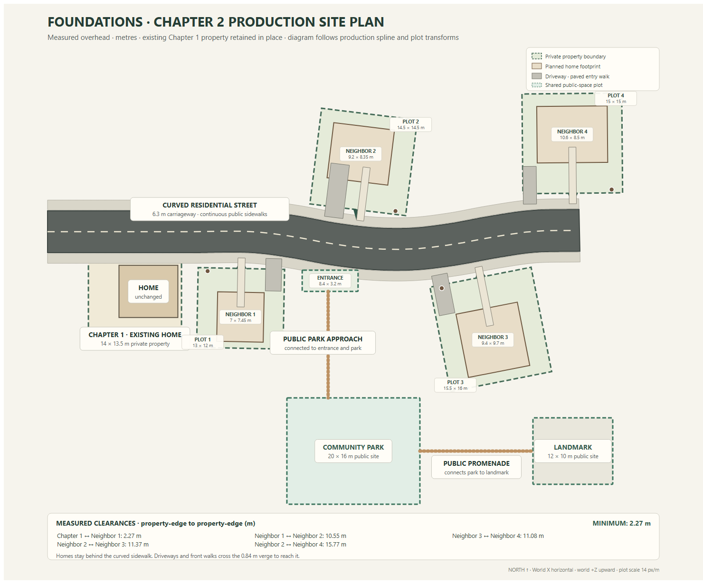

# Chapter 2 production site plan

This is the authored overhead site-plan view rendered directly from `CHAPTER_TWO_SITE_PLAN` and the same road spline used by the production assets. Measurements are metres. North is up; world +Z is up in the drawing.

| Parcel | Property width × depth | Planned house width × depth × height | Side / back / front inset | Street frontage |
|---|---:|---:|---|---|
| Chapter 1 (existing) | 14 × 13.5 | 8.85 × 7.87 × 6.58 measured | sides 4.60 / 0.55; back/front 4.29 / 1.35 | unchanged |
| Neighbor 1 | 13 × 12 | 7 × 7.45 × 5.9 | sides 3.00 / 3.00; back/front 0.98 / 3.57 | north |
| Neighbor 2 | 14.5 × 14.5 | 9.2 × 8.35 × 5.6 | sides 3.22 / 2.08; back/front 1.92 / 4.23 | south |
| Neighbor 3 | 15.5 × 16 | 9.4 × 9.7 × 7.5 | sides 3.05 / 3.05; back/front 1.55 / 4.75 | north |
| Neighbor 4 | 15 × 15 | 10.6 × 8.5 × 6.5 | sides 2.20 / 2.20; back/front 1.90 / 4.60 | south |

The curved carriageway is 6.3 m wide, with 1.48 m public sidewalks centered 4.02 m from the road centerline. The district contract is 132 × 90 m. Neighbor frontage is placed 5.6 m from the road centerline.

The minimum private property edge clearance is **2.27 m**, between the unchanged Chapter 1 property and Neighbor 1. The nearest five measured pair clearances are:

| Property pair | Edge clearance |
|---|---:|
| Chapter 1 ↔ Neighbor 1 | 2.27 m |
| Neighbor 1 ↔ Neighbor 2 | 10.55 m |
| Neighbor 3 ↔ Neighbor 4 | 11.08 m |
| Neighbor 2 ↔ Neighbor 3 | 11.37 m |
| Neighbor 2 ↔ Neighbor 4 | 15.77 m |

Public feature footprints and nearest private-property clearances:

| Public site | Width × depth | Nearest private-property clearance |
|---|---:|---:|
| entrance | 8.4 × 3.2 | 2.65 m to Neighbor 1 |
| community-park | 20 × 16 | 4.71 m to Neighbor 3 |
| landmark | 12 × 10 | 6.28 m to Neighbor 3 |

Driveways and front walks remain owned by their residential lot and cross the front boundary, the 0.84 m planted verge, and the sidewalk apron to meet the public route. House footprints remain behind the curved sidewalk. The entrance connects the north sidewalk to the park approach; the park and landmark share a public promenade. The original Chapter 1 property and home coordinates remain unchanged. No vehicle assets are included.

The SVG and JSON data can be regenerated together with `node scripts/render-chapter-two-site-plan.cjs`.
