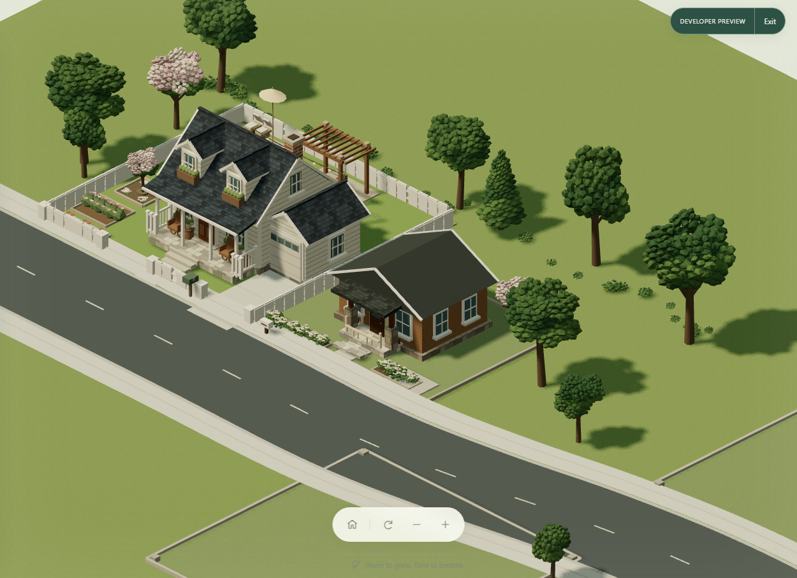
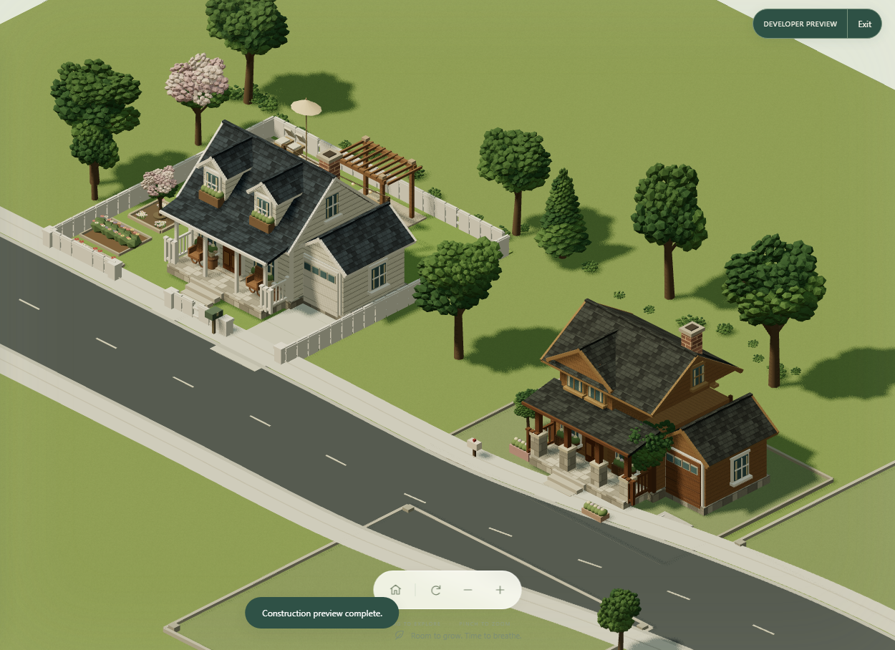
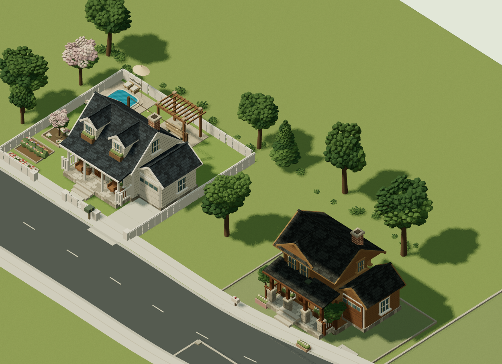
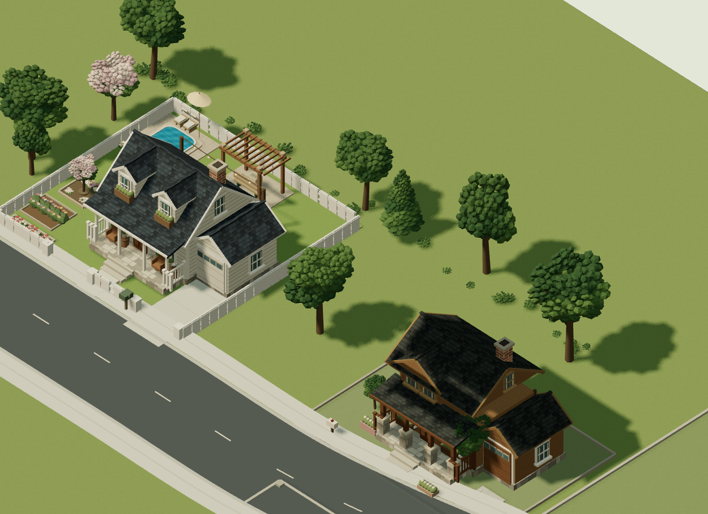
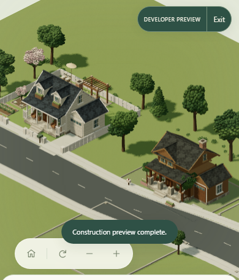
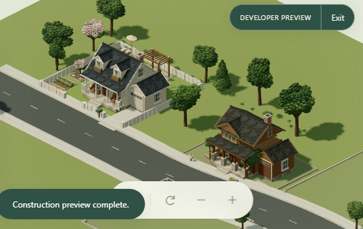

# Chapter 2 proof comparison

Captured from the production Angular bundle in a fresh Developer Preview profile at 1600 × 1000, with daylight, a fixed isometric camera, and the same 0.72 zoom. The player home is Cottage; the independently selected proof neighbor is Craftsman.

The proof lot has an 8.5 m side gap from the Chapter 1 property envelope. The standard Chapter 2 first-neighbor lot and the preview proof use the same road and continuous world, but the proof parcel is deliberately wider and farther east to demonstrate detached-home spacing.

## Existing Chapter 2 neighbor

## Framework proof

## Staged construction

| Early | Middle | Complete |
|---|---|---|
|  |  |  |

## Responsive browser captures

The screenshots are browser render captures, not physical-device photos or an FPS benchmark. The JSON alongside each screenshot records the camera, visible mesh count, draw calls, triangle count, WebGL context state, and browser diagnostics.
