# Urban cohesion evidence

The [comparison gallery](index.html) pairs twelve before/after views. [Labeled plan](site-plan.png), [source SVG](site-plan.svg), [geometry diagnostics](site-plan-checks.json), [final capture gallery](after/index.html), and [raw renderer observations](after/metrics.json) accompany the review.

Baseline application: `ce9506d8` (current main including merged PR #6). Final application source: `42659f3`. Baseline metadata marks the working tree dirty because capture/diagnostic scaffolding was being prepared; baseline application sources were unchanged. Final capture was run from committed source. Documentation and screenshots are committed afterward.

## Composition and visual assessment

- The residential road continues straight into a compact Main Street. Shops now share its north sidewalk; the library faces them. Marked crossings meet continuous sidewalks. Previously, rotated sidewalk strips crossed the road and the connector disappeared into lawn.
- The civic square closes the street. Its north walk meets the greenway, which joins the existing neighborhood park/landmark promenade. A reading walk and bounded greens define quieter land behind the frontages.
- Stations stand beside the neighborhood promenade and civic square, with approaches reaching their real lift entrances. The guideway follows a smaller perimeter; offset piers and independently articulated coaches keep the hanging train clear on bends.
- Original home and Chapter 2 residential plots/models are unchanged. Home camera code/framing is unchanged.
- These remain stylized procedural assets. The improved composition is stronger than the baseline, but the station is still a simplified open structure, lawns remain deliberately spacious around the established homes, and the square is quiet rather than densely detailed. This pass does not claim the architectural richness of the reference boards.

Station comparisons keep angle/zoom but follow each station's relocated target. Other pairs retain fixed world cameras. Screenshots were inspected at gameplay angles as well as overhead. Desktop static views honor reduced motion; mobile views enable ambient motion. Preview is isolated from real saved data throughout capture.

## Executed validation

| Check                                                                          | Result                                                                                                                               |
| ------------------------------------------------------------------------------ | ------------------------------------------------------------------------------------------------------------------------------------ |
| Existing + focused unit/component suite                                        | **PASS** — 34 files, 267 tests                                                                                                       |
| Production build                                                               | **PASS** — `/foundations/` base path; 347.28 kB initial, 742.48 kB lazy scene (raw)                                                  |
| Plot hierarchy, clearance and pedestrian diagnostics                           | **PASS** — no issues; broken station approach negative test detects disconnection                                                    |
| Rail support spacing                                                           | **PASS** — maximum physical span 10.97 m including station heads and closing loop; limit 12 m                                        |
| Vehicle envelope                                                               | **PASS** — both coaches sampled at 480 lap positions against all 44 free piers                                                       |
| Boarding height / stair headroom                                               | **PASS** — actual mesh raycasts; all four flights at both stations; separate read-only review checked additional tread-width samples |
| All 15 existing city choices: replay, skip and reduced-motion final transforms | **PASS** — focused automated checks                                                                                                  |
| Save/progression/preview regression coverage                                   | **PASS** — retained in full suite; no schema, IDs or thresholds changed                                                              |
| Physical phone / Safari / hardware GPU performance                             | **NOT VERIFIED**                                                                                                                     |
| Merge / deployment                                                             | **SKIPPED** — draft PR only, as requested                                                                                            |

The geometry tests first reproduced the old sidewalk orientation, doubled approach origin, blocked station channel, rigid-tail collision and incorrect boarding height. A read-only review also found overlapping stairs and a deck obstruction; both were repaired and checked again. The optional browser capture script is manual evidence tooling, not an E2E test or a CI/deployment gate.

## Remaining risks and mitigation

Renderer counts and viewport observations are recorded below after capture. Software-rendered frame pacing is not a physical-device benchmark. A hardware phone check remains necessary before treating the larger city as performance-ready. Draw calls are still high for a small app; use the supplied matching cameras/counters to guide targeted batching or foliage LOD work separately, without changing home appearance in this pass.

Walking connectivity is validated geometrically; there are no simulated pedestrians, lift passengers or train boarding. Stair/rail assets communicate access, but this is not an accessibility or structural-engineering simulation. Future city expansion should extend the existing plan/plot definitions and camera boundaries deliberately, rather than introducing disconnected worlds. The current camera bounds were preserved.

## Same-view examples

| View                                         | Before                                                  | After                                                 |
| -------------------------------------------- | ------------------------------------------------------- | ----------------------------------------------------- |
| Main Street                                  | 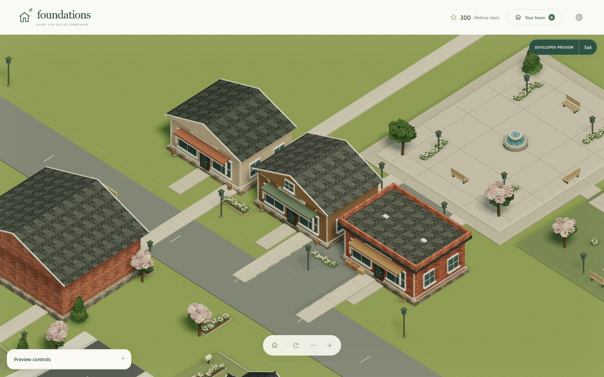  | 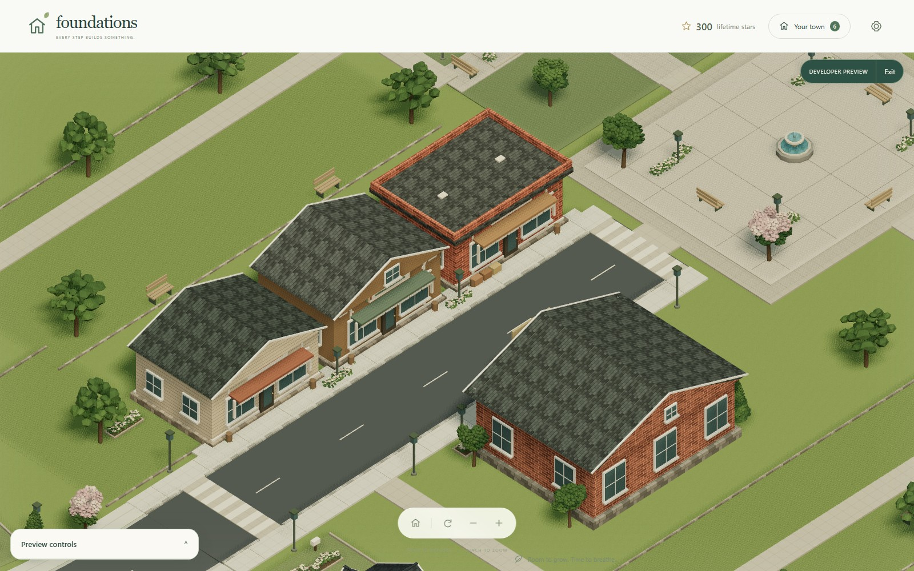  |
| Residential transition                       | 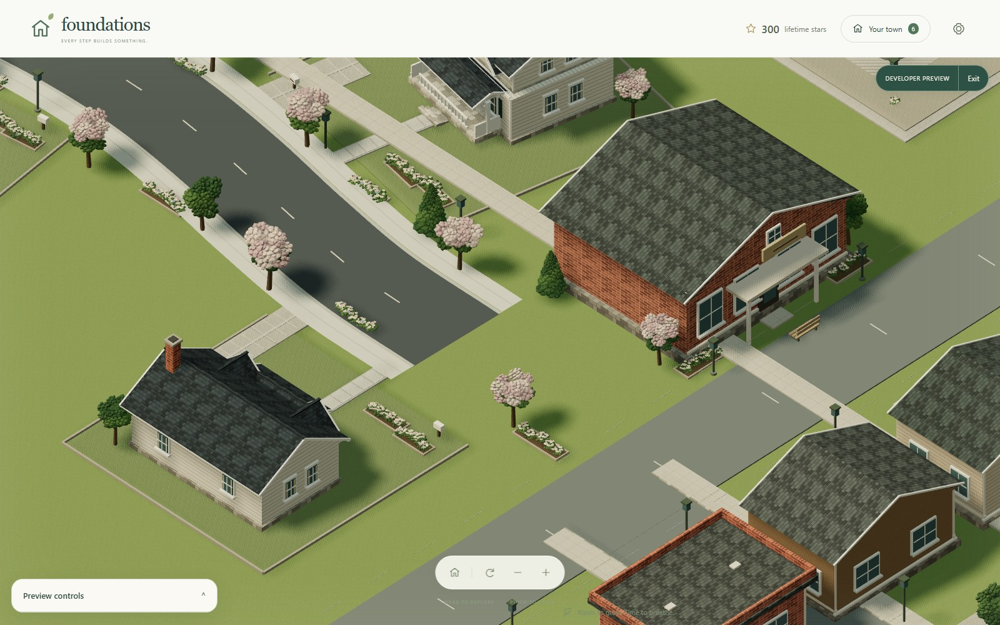 | 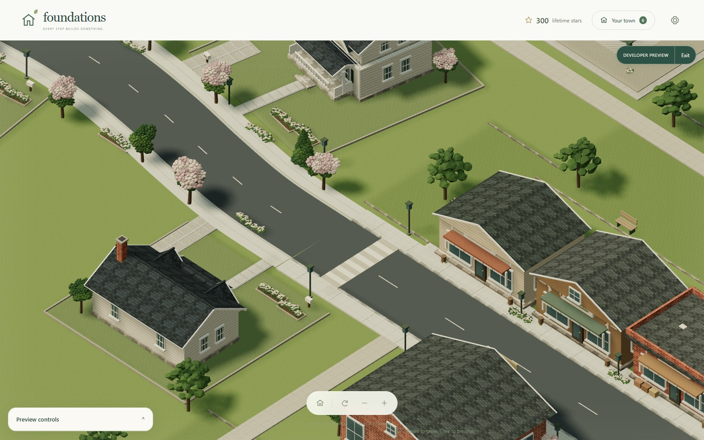 |
| Entire rail loop                             | 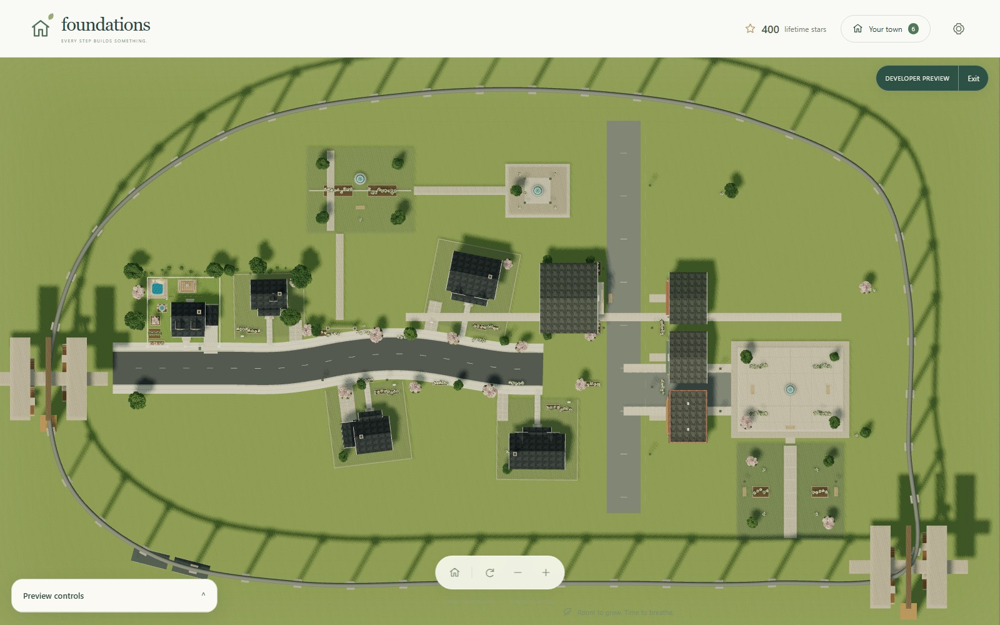          | 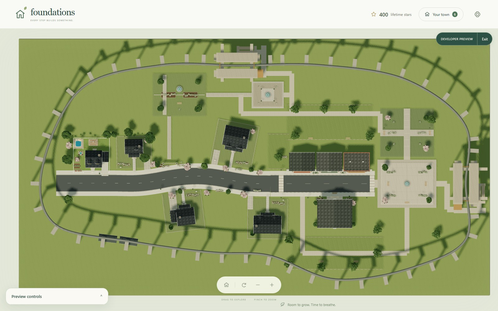          |
| Town station (same angle/zoom, moved target) | 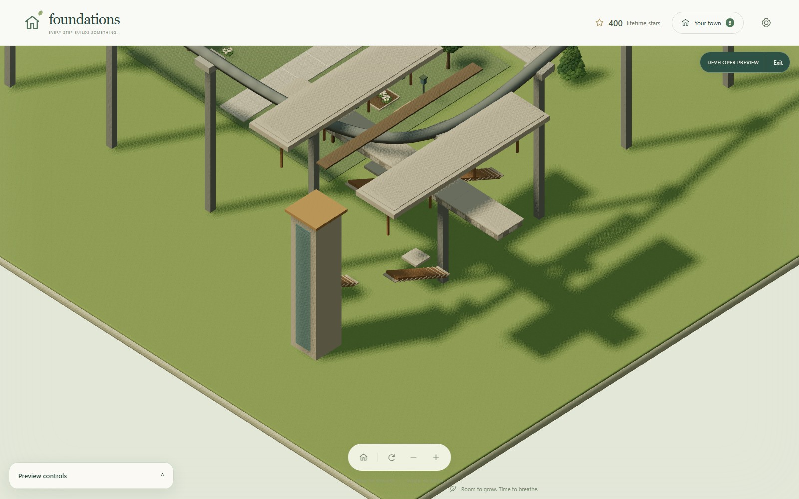              | 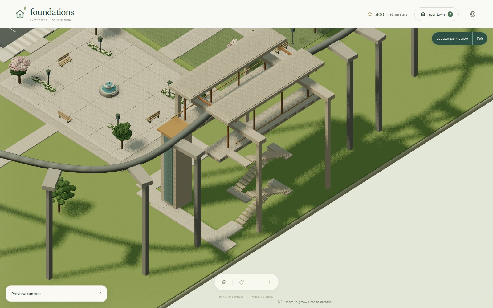              |
| Portrait                                     | 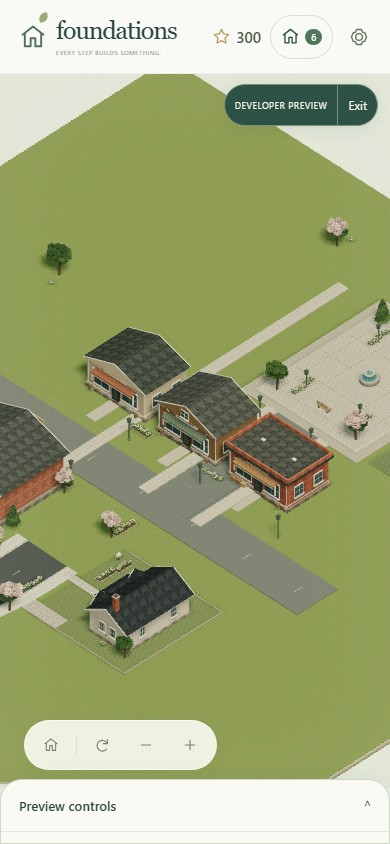          | 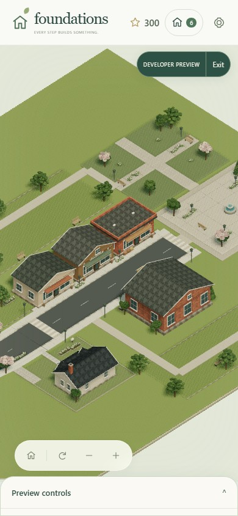          |
| Landscape                                    | 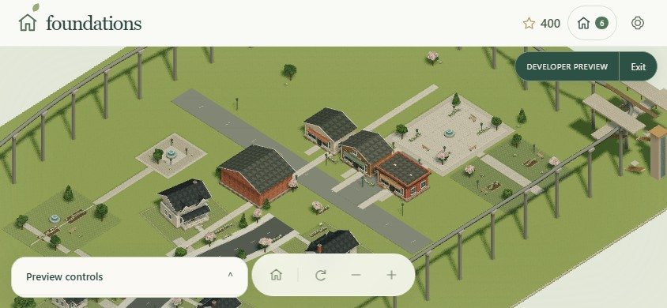        | 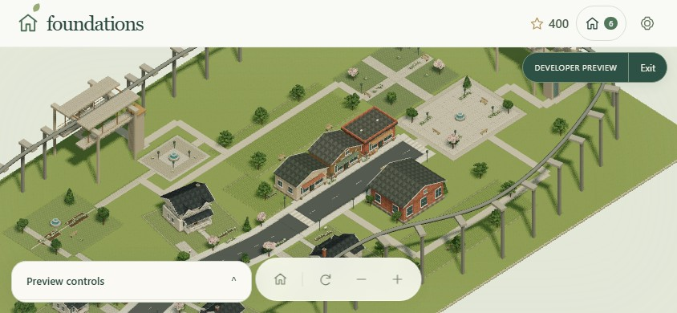        |

## Final browser observations and renderer counters

**PASS:** 17 final production captures; portrait 390×844 and landscape 844×390 have no horizontal document overflow. All captures report rendered canvas, WebGL error 0 and no lost context. No JavaScript or console errors were recorded. Four SwiftShader `ReadPixels` stall warnings occurred during capture, also present in baseline.

**PASS:** observed mouse pan, wheel zoom and rotation; touch pan, pinch zoom and Home reset in both mobile orientations; moving train; construction Skip visible and clicked; natural-speed completion; reduced-motion completion; Chapter 3 welcome replay. These are optional browser observations, not a deployment gate. Static screenshots cannot prove animation quality: the slow-assembly image retains its Skip banner but its pieces may already have settled by the time software rendering finishes capturing.

| Matching view        | Draw calls before → after |   Triangles before → after | Software FPS before → after |
| -------------------- | ------------------------: | -------------------------: | --------------------------: |
| Portrait, Chapter 3  |         302 → 330 (+9.3%) |  526,490 → 499,405 (−5.1%) |                     ~5 → ~5 |
| Landscape, Chapter 4 |         644 → 647 (+0.5%) | 925,779 → 826,240 (−10.8%) |                     ~2 → ~2 |

Counts are Three.js `renderer.info.render` observations, not GPU timing. Same viewport, camera, scenario, afternoon lighting, and enabled mobile ambient motion; train position and foliage may differ in time. Renderer is ANGLE Vulkan SwiftShader software. Small frame samples (8 and4 final intervals) and slow desktop software rendering cannot establish phone performance. Added walking/landscape material groups raise portrait submissions despite fewer triangles. Recommendation: review this layout in the draft, then measure representative hardware before a separate targeted draw-call/LOD optimization. No mobile-performance improvement is claimed.

A screenshot attempt initially timed out because the animation finished while the software screenshot was being captured; the evidence script now replays before clicking Skip. The complete final run exited 0 with all observations above true. It adds no CI or deployment dependency.
