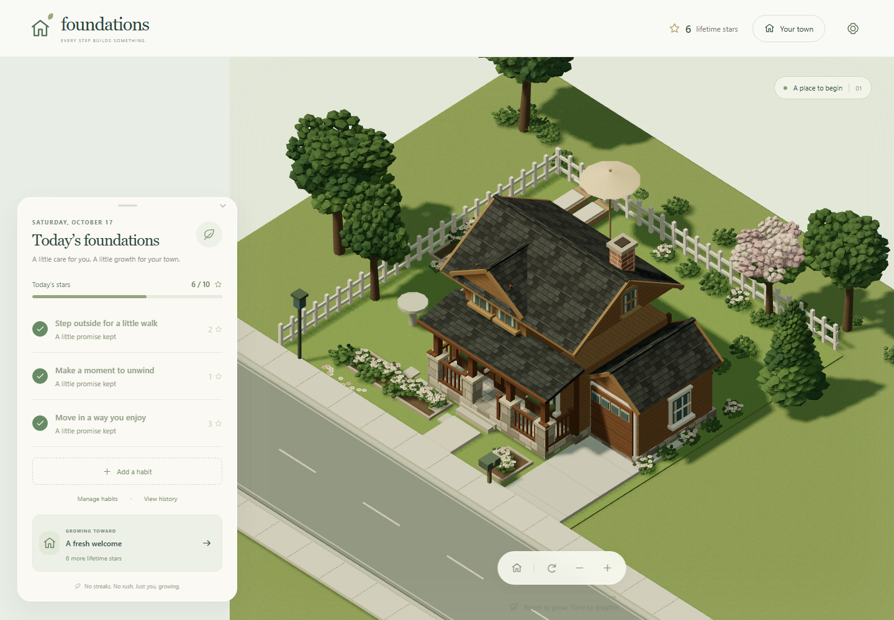
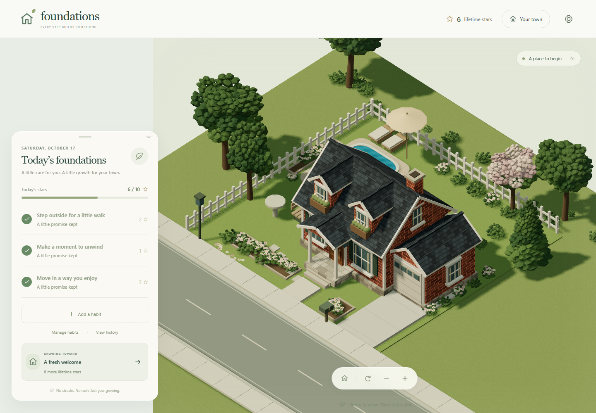
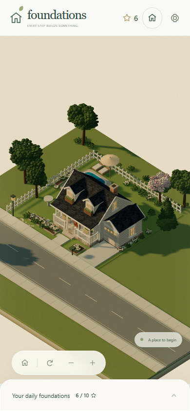
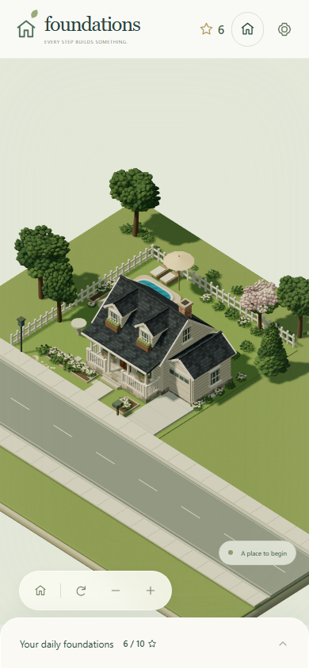
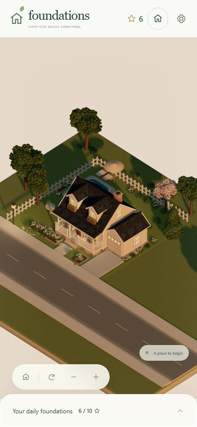
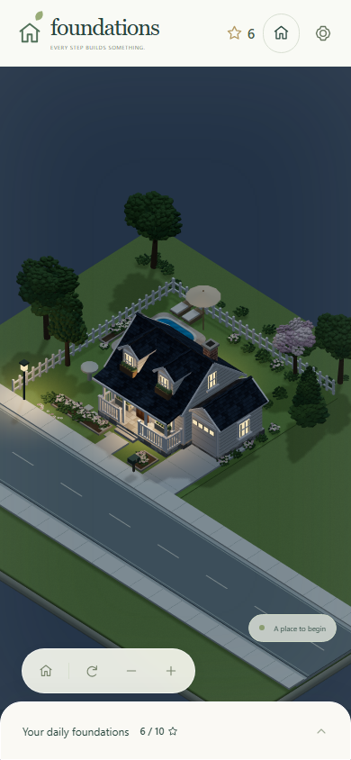
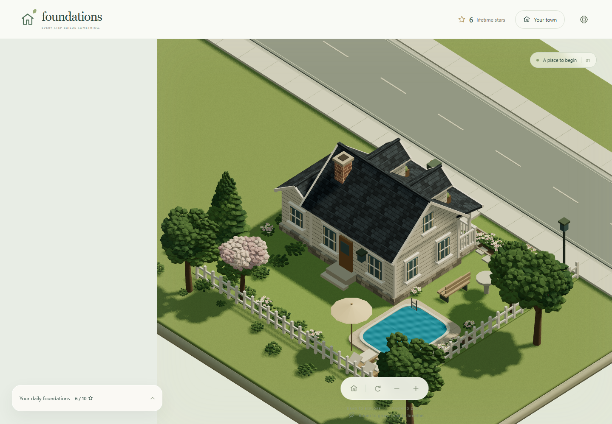
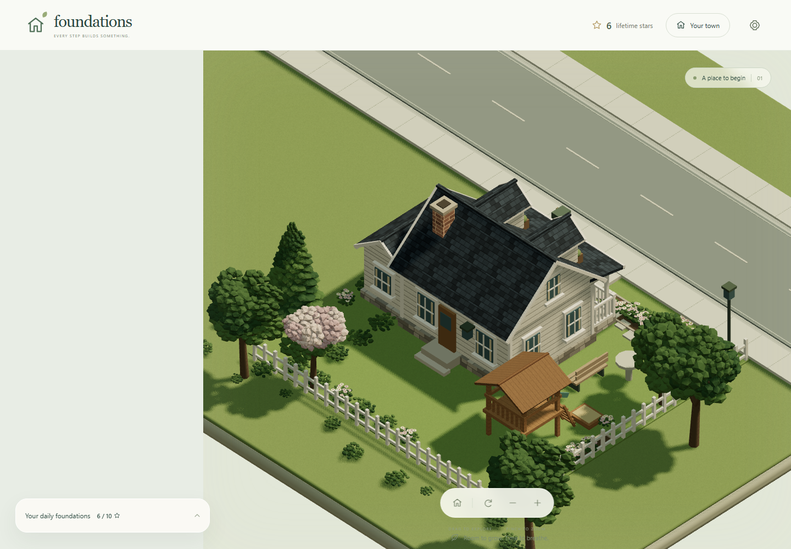
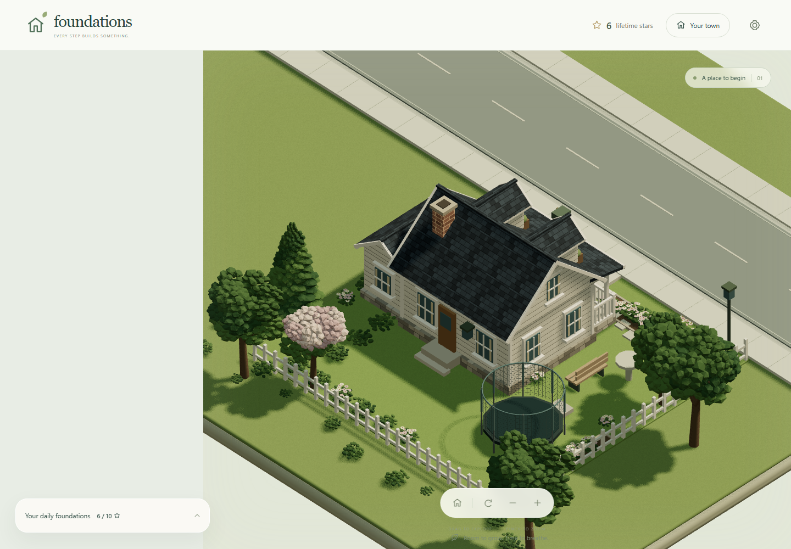

# Visual Production Pass 1 — review and evidence

2026-10-17. [Repository](https://github.com/HaydenMay/foundations) · [Live app](https://haydenmay.github.io/foundations/). Starting residential lot only; later neighborhoods have not been built or reworked.

## Delivered

Three freely reversible starting houses share one logical lot, entrance, empty driveway and backyard zone: Classic Cottage (cream clapboard, twin dormers, white porch), Modern Craftsman (timber, layered gables, stone porch bases), Traditional Brick (red-brown brick, shutters, white trim and portico). All have attached garage wings, detailed windows, doors, steps, chimney and deliberate rear elevations. No cars are present.

Landscaping now includes irregular leaf sprays, oak/birch/flowering deciduous silhouettes, an evergreen, mixed flowering shrubs, low hedges, bordered beds, mailbox, birdbath, benches and fencing. Small original surface maps add clapboard, masonry, shingles, timber and lawn detail. Materials and geometry are shared and statically batched, with disposal on replacement. [Asset conventions and replacement contract](visual-assets.md).

The existing five-star backyard choices are rebuilt as a rounded pool with coping/patio/loungers/parasol, cedar fort with supported roof/ladder/slide/sandbox, and trampoline with metal frame and transparent safety enclosure. Existing twelve-star roof improvements still work. Construction and design changes award/spend no stars.

Four local-time moods blend sun direction, color, ambient fill and window light. Morning is soft gold, afternoon is balanced daylight, sunset is amber with long shadows, night is blue with warm windows/porch/street lamps. Existing manual overrides persist. Timing remains fixed local hours rather than geographical sunrise/sunset. Palettes interpolate between fixed hours; the scene samples the clock each minute. No perpetual animation loop is enabled.

Home now frames the house more closely and keeps consistent scale between expanded/collapsed phone panels. Existing touch pan/pinch, wheel/mouse pan, rotation, keyboard controls, boundaries and Home remain. The large introductory overlay is clipped from the scene; the philosophy appears in the compact header. The habit interface remains the existing implementation.

## Screenshots

These are actual production-build Chromium screenshots, not generated illustrations. Fresh browser profiles use only synthetic starter completions. Toasts are hidden in the capture page so they do not obscure art; there is no shipped screenshot/diagnostic code. Click an image for full size.

| Classic Cottage                                                            | Modern Craftsman                                                              | Traditional Brick                                                          |
| -------------------------------------------------------------------------- | ----------------------------------------------------------------------------- | -------------------------------------------------------------------------- |
|  |  |  |

Phone views: [Cottage](evidence/visual-pass-1/final/house-cottage-portrait.png) · [Craftsman](evidence/visual-pass-1/final/house-craftsman-portrait.png) · [Brick](evidence/visual-pass-1/final/house-brick-portrait.png).

| Morning                                                                 | Afternoon                                                             | Sunset                                                                | Night                                                               |
| ----------------------------------------------------------------------- | --------------------------------------------------------------------- | --------------------------------------------------------------------- | ------------------------------------------------------------------- |
|  |  |  |  |

| Pool                                                            | Wooden fort                                                     | Trampoline                                                                  |
| --------------------------------------------------------------- | --------------------------------------------------------------- | --------------------------------------------------------------------------- |
|  |  |  |

All nine house/backyard combinations were captured from the rear and checked for readable house elevations, usable project locations and stable stars:

| Rear elevation | Pool                                                         | Fort                                                         | Trampoline                                                         |
| -------------- | ------------------------------------------------------------ | ------------------------------------------------------------ | ------------------------------------------------------------------ |
| Cottage        | [View](evidence/visual-pass-1/final/rear-cottage-pool.png)   | [View](evidence/visual-pass-1/final/rear-cottage-fort.png)   | [View](evidence/visual-pass-1/final/rear-cottage-trampoline.png)   |
| Craftsman      | [View](evidence/visual-pass-1/final/rear-craftsman-pool.png) | [View](evidence/visual-pass-1/final/rear-craftsman-fort.png) | [View](evidence/visual-pass-1/final/rear-craftsman-trampoline.png) |
| Brick          | [View](evidence/visual-pass-1/final/rear-brick-pool.png)     | [View](evidence/visual-pass-1/final/rear-brick-fort.png)     | [View](evidence/visual-pass-1/final/rear-brick-trampoline.png)     |

Responsive checks: [390×844 expanded](evidence/visual-pass-1/final/portrait-day-expanded.png) / [collapsed](evidence/visual-pass-1/final/portrait-day-collapsed.png), [390×664 compact expanded](evidence/visual-pass-1/final/compact-portrait-day-expanded.png) / [collapsed](evidence/visual-pass-1/final/compact-portrait-day-collapsed.png), [844×390 landscape expanded](evidence/visual-pass-1/final/landscape-day-expanded.png) / [collapsed](evidence/visual-pass-1/final/landscape-day-collapsed.png), [1440×1000 desktop](evidence/visual-pass-1/final/desktop-day-expanded.png).

Existing roof improvements: [Terracotta](evidence/visual-pass-1/final/exterior-clay-desktop.png) · [Evening slate](evidence/visual-pass-1/final/exterior-slate-desktop.png) · [Forest green](evidence/visual-pass-1/final/exterior-moss-desktop.png). [Reloaded saved Brick/trampoline view](evidence/visual-pass-1/final/rear-brick-trampoline-reloaded.png).

## Executed validation

| Check                                     | Result                               | Evidence / scope                                                                                                                                                                                                                                                                                                                                                                     |
| ----------------------------------------- | ------------------------------------ | ------------------------------------------------------------------------------------------------------------------------------------------------------------------------------------------------------------------------------------------------------------------------------------------------------------------------------------------------------------------------------------ |
| Unit suite                                | **PASS — 52/52**                     | Existing scoring, cap/partial rewards, eligibility, daily/weekly/one-time rules, permanent history, milestones, persistence/import/export; new legacy IDs/free switching, geometry/yard bounds, batching, resource disposal, roof UVs, fort supports, pool coping, light continuity and framing contracts.                                                                           |
| Full local browser suite                  | **PASS — 47; SKIPPED — 1; FAIL — 0** | Portrait, landscape, desktop; existing habits/history/backups/multi-tab/debounce controls; new all-style persistence, all house×yard changes, twelve-star legacy town/archival/roof preservation, Auckland clock moods, override/reload, canvas framing/errors. Last local full run preceded final geometry-only review fixes; publication CI runs the suite against the final code. |
| Production build                          | **PASS**                             | Strict Angular/TypeScript build, `/foundations/` base, no warnings. Initial shell 267.79 kB raw / ~72.9 kB estimated transfer; lazy scene ~631 kB raw / ~136 kB transfer.                                                                                                                                                                                                            |
| Final capture script                      | **PASS — 33 captures**               | Four viewport sizes, both panel states, three houses, four moods, nine yard pairings, three exterior upgrades and reload. Zero console/page/WebGL errors or context losses across captures.                                                                                                                                                                                          |
| GitHub Actions / Pages                    | **PASS**                             | [Run 39044066377](https://github.com/HaydenMay/foundations/actions/runs/39044066377), both jobs successful for `932ac69`. Ubuntu unit 52/52; browser 47 PASS / 1 SKIPPED / 0 FAIL (4.4 minutes); production build successful; npm audit: 0 vulnerabilities.                                                                                                                          |
| Live browser verification                 | **PASS — 12/12**                     | Actual Pages URL, portrait/landscape/desktop: house choices, legacy history/roof/stars, reloads, panel preference and framing. Fresh profiles only.                                                                                                                                                                                                                                  |
| Physical phones / Safari / low-memory GPU | **SKIPPED**                          | No physical-device or actual Safari testing performed. Chromium touch/viewport emulation is not a substitute.                                                                                                                                                                                                                                                                        |
| Optional ambient animation                | **SKIPPED by design**                | Static art and event-driven idle battery use took priority. Water/tree motion remains off.                                                                                                                                                                                                                                                                                           |

The only skipped browser test is desktop's touch-only gesture case; the gesture runs in both phone projects. An initial new landscape test failed because it dereferenced the bounding box of an already hidden heading; corrected to accept hidden text. The shingle orientation regression failed before its UV correction and passed afterward. Review also corrected the old exterior bench/planter overlap and a floating fort canopy, with geometric regressions for roof contact and pool construction.

## Performance observations

[Final metrics](evidence/visual-pass-1/final/metrics.json) identify source `932ac69` and contain all 33 captures. Representative home view: **74 steady draw calls; 115 with a shadow refresh**, versus baseline **645** with uncached shadows. Scene meshes fell from **338 to 74**, shadow casters from **337 to 41**. Richer foliage raises submitted triangles from **18,438 to 186,792** in those representative views. These are different art/framing revisions, not a controlled GPU benchmark. Across the final captures: **74–96 steady calls**, **186,792–196,610 triangles**, warm CPU-submission p95 **0.8–1.4 ms** (12 samples per view). All four layouts rendered **zero additional frames during 700 ms of settled idle**. After nine house/yard switches, the final Brick/trampoline view and its fresh reload both report **83 geometries / 24 textures / 6 programs**; this limited telemetry found no accumulated rendered-resource growth, but is not a long-session memory certification. The [baseline](evidence/visual-pass-1/baseline/metrics.json) and [inspection](visual-pass-1-inspection.md) preserve the original implementation's figures and images. Measurements use Windows headless Chromium, emulated phone pixel ratio two and a short warm camera-render sample. CPU submission timings are not GPU time or phone FPS.

Static batching reduces draw submissions substantially; richer foliage increases triangles. Shadows are refreshed on geometry/light changes and cached during camera motion. The renderer remains event-driven at rest. A much larger future city needs spatial batches/LOD, and real mobile devices must determine the final pixel-ratio/shadow/foliage quality budget.

## Reference comparison, limits and mitigation

The houses follow the boards' architectural language: cream siding and dormers, warm Craftsman timber/stone, classic red brick/white trim, fine roof courses, porches, garage wings, gardens and warm night windows. The three choices remain reversible; the empty driveways deliberately differ from the pictured cars.

Meaningful compromises remain. Leaf sprays are visibly faceted at close zoom and less irregular/dense than the reference foliage. Small original repeating maps replace authored PBR textures. The single-sun/ambient setup lacks baked global illumination/contact occlusion, cinematic bloom, reflective/refractive pool water and photographic depth of field. Shadows are restrained real-time shadows rather than the reference's offline softness. The camera reveals the existing terrain slice and open future lots, rather than a continuous dense town. Later milestone houses retain their earlier provisional models. These limits are visible in the screenshots; this pass does not claim offline-render parity.

Practical mitigation: review the starting lot with the owner first, then measure real iOS/Android/Safari behavior. If closer reference fidelity is approved, replace individual houses/foliage with optimized authored GLTF assets and an original foliage atlas, add carefully baked occlusion, and measure each addition. Keep the current anchors and saved IDs. Do not add neighborhoods or postprocessing until that review and hardware budget are settled. Local storage can still be cleared by the browser; retain JSON backups as documented in the README.

## Publication record

Implementation commits: `4fa192c`, `0502f55`, `932ac69`. One independent read-only reviewer assessed the source, all 33 pre-final-correction captures, then the two final art corrections in source and five refreshed phone/desktop views. **Verdict: ready for this visual pass; no remaining material defect found.** The reviewer explicitly retained the foliage/surface/reference-fidelity caveat and did not certify physical devices or deployment.

[GitHub Actions run 39044066377](https://github.com/HaydenMay/foundations/actions/runs/39044066377) **succeeded**, deploying `932ac69571e95aca59d5f23b3f123b1fae184876`. GitHub deployment 7141605679 records that SHA and the github-pages environment. Build job 5m 7s; deploy 9s.

Live HTTPS verification: **200**, title `Foundations`, base `/foundations/`, served module `main-JYVXGBJF.js` matching the local final build. Live browser subset **12/12 PASS** in 1.4 minutes. Additional actual-live [portrait](evidence/visual-pass-1/live/portrait.png) and [landscape](evidence/visual-pass-1/live/landscape.png) captures show rendered canvas, no horizontal overflow, zero page/console errors, and observed requests only to haydenmay.github.io. [Structured verification record](evidence/visual-pass-1/live/verification.json).

CI emitted upstream action-runtime and ubuntu-latest migration notices. Both jobs succeeded; these are maintenance items for the next CI review, not unresolved application test failures. Final evidence/README changes are committed separately with `[skip ci]`; no application code changes after the verified deployed `932ac69`.
